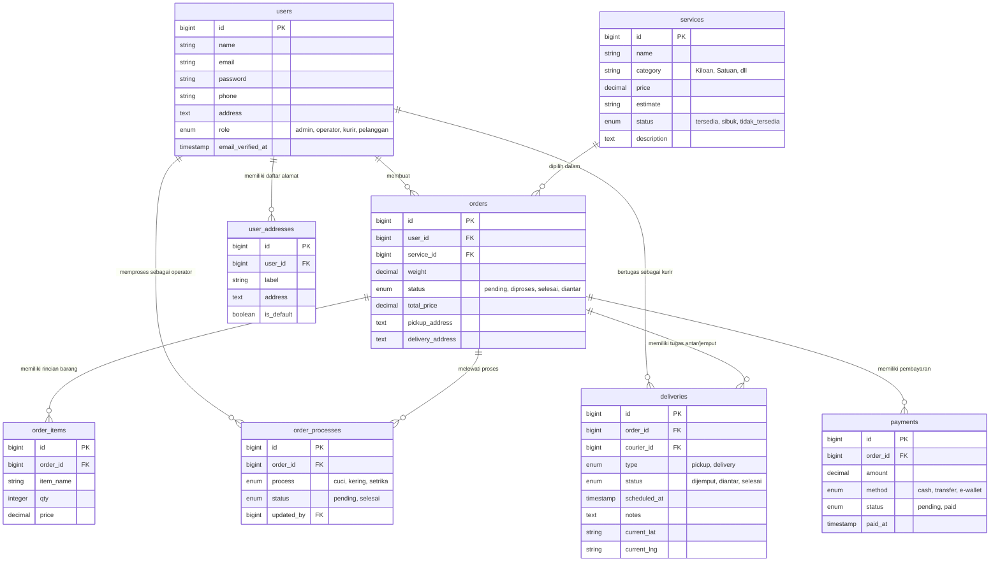
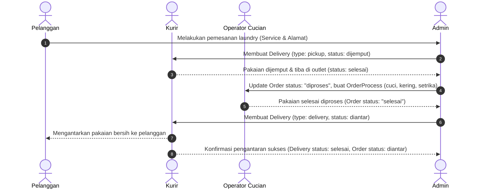

# Dokumentasi Sistem: Database & Controller (Laundry Coin)

Dokumen ini menyajikan rincian teknis mengenai struktur basis data, skema tabel, relasi entitas, serta seluruh controller dan fungsionalitasnya yang diterapkan pada sistem **Laundry Coin** (Project Management Web Laundry).

---

## 1. Ringkasan Sistem & Konfigurasi Basis Data

- **Framework**: Laravel 11 dengan Inertia.js
- **Database Engine**: MySQL (`DB_CONNECTION=mysql`)
- **Nama Database**: `Sistem-Manajemen-Laundry`
- **Host & Port**: `127.0.0.1:3306`
- **Session & Queue**: Database-backed (`SESSION_DRIVER=database`, `QUEUE_CONNECTION=database`, `CACHE_STORE=database`)

---

## 2. Diagram Relasi Entitas (ERD)

---

## 3. Kamus Data (Data Dictionary)

### 3.1. Tabel `users`
Model: `App\Models\User`

| Kolom | Tipe Data | Atribut | Keterangan |
| :--- | :--- | :--- | :--- |
| `id` | `BIGINT UNSIGNED` | Primary Key, Auto Increment | Identifikasi unik pengguna |
| `name` | `VARCHAR(255)` | Not Null | Nama lengkap pengguna |
| `email` | `VARCHAR(255)` | Not Null, Unique | Email aktif untuk login & notifikasi |
| `email_verified_at` | `TIMESTAMP` | Nullable | Tanggal & waktu verifikasi email |
| `password` | `VARCHAR(255)` | Not Null | Kata sandi terenkripsi (Bcrypt) |
| `phone` | `VARCHAR(20)` | Nullable | Nomor WhatsApp / telepon |
| `address` | `TEXT` | Nullable | Alamat utama pengguna |
| `role` | `ENUM` | Default: `'pelanggan'` | Hak akses: `'admin'`, `'operator'`, `'kurir'`, `'pelanggan'` |
| `remember_token` | `VARCHAR(100)` | Nullable | Token untuk fitur *Remember Me* |
| `created_at` / `updated_at` | `TIMESTAMP` | Nullable | Waktu pembuatan & modifikasi akun |

---

### 3.2. Tabel `services`
Model: `App\Models\Service`

| Kolom | Tipe Data | Atribut | Keterangan |
| :--- | :--- | :--- | :--- |
| `id` | `BIGINT UNSIGNED` | Primary Key, Auto Increment | Identifikasi unik layanan |
| `name` | `VARCHAR(255)` | Not Null | Nama paket/layanan (contoh: Cuci Komplit, Setrika Kilat) |
| `category` | `VARCHAR(100)` | Default: `'Kiloan'` | Kategori layanan (`Kiloan`, `Satuan`, dll) |
| `price` | `DECIMAL(10,2)` | Not Null | Tarif dasar layanan |
| `estimate` | `VARCHAR(100)` | Default: `'1-2 Hari'` | Estimasi waktu pengerjaan |
| `status` | `ENUM` | Default: `'tersedia'` | Ketersediaan: `'tersedia'`, `'sibuk'`, `'tidak_tersedia'` |
| `description` | `TEXT` | Nullable | Keterangan/deskripsi layanan |
| `created_at` / `updated_at` | `TIMESTAMP` | Nullable | Waktu rekaman dibuat & diubah |

---

### 3.3. Tabel `orders`
Model: `App\Models\Order`

| Kolom | Tipe Data | Atribut | Keterangan |
| :--- | :--- | :--- | :--- |
| `id` | `BIGINT UNSIGNED` | Primary Key, Auto Increment | Nomor identifikasi pesanan (INV / ORD) |
| `user_id` | `BIGINT UNSIGNED` | Foreign Key (`users.id`) | ID pelanggan pemesan (Cascade on delete) |
| `service_id` | `BIGINT UNSIGNED` | Foreign Key (`services.id`)| ID layanan yang dipilih |
| `weight` | `DECIMAL(8,2)` | Default: `1.00` | Bobot cucian dalam kilogram |
| `status` | `ENUM` | Default: `'pending'` | Status order: `'pending'`, `'diproses'`, `'selesai'`, `'diantar'` |
| `total_price` | `DECIMAL(10,2)` | Not Null | Total biaya transaksi pesanan |
| `pickup_address` | `TEXT` | Not Null | Alamat penjemputan cucian |
| `delivery_address`| `TEXT` | Not Null | Alamat pengantaran cucian bersih |
| `created_at` / `updated_at` | `TIMESTAMP` | Nullable | Waktu pesanan dibuat & diubah |

---

### 3.4. Tabel `order_items`
Model: `App\Models\OrderItem`

| Kolom | Tipe Data | Atribut | Keterangan |
| :--- | :--- | :--- | :--- |
| `id` | `BIGINT UNSIGNED` | Primary Key, Auto Increment | ID unik item |
| `order_id` | `BIGINT UNSIGNED` | Foreign Key (`orders.id`) | ID pesanan induk (Cascade on delete) |
| `item_name` | `VARCHAR(255)` | Not Null | Nama pakaian/barang (misal: Kemeja, Selimut, Jas) |
| `qty` | `INT` | Not Null | Jumlah kuantitas pakaian |
| `price` | `DECIMAL(10,2)` | Not Null | Harga per unit barang |
| `created_at` / `updated_at` | `TIMESTAMP` | Nullable | Waktu rekaman |

---

### 3.5. Tabel `order_processes`
Model: `App\Models\OrderProcess`

| Kolom | Tipe Data | Atribut | Keterangan |
| :--- | :--- | :--- | :--- |
| `id` | `BIGINT UNSIGNED` | Primary Key, Auto Increment | ID langkah proses |
| `order_id` | `BIGINT UNSIGNED` | Foreign Key (`orders.id`) | ID pesanan terkait (Cascade on delete) |
| `process` | `ENUM` | Not Null | Tahapan pengerjaan: `'cuci'`, `'kering'`, `'setrika'` |
| `status` | `ENUM` | Default: `'pending'` | Status tahapan: `'pending'`, `'selesai'` |
| `updated_by` | `BIGINT UNSIGNED` | Foreign Key (`users.id`) | ID akun operator yang mengupdate (Set null on delete) |
| `created_at` / `updated_at` | `TIMESTAMP` | Nullable | Waktu proses diperbarui |

---

### 3.6. Tabel `deliveries`
Model: `App\Models\Delivery`

| Kolom | Tipe Data | Atribut | Keterangan |
| :--- | :--- | :--- | :--- |
| `id` | `BIGINT UNSIGNED` | Primary Key, Auto Increment | ID tugas logistik |
| `order_id` | `BIGINT UNSIGNED` | Foreign Key (`orders.id`) | ID pesanan terkait (Cascade on delete) |
| `courier_id` | `BIGINT UNSIGNED` | Foreign Key (`users.id`) | ID kurir yang bertugas (Set null on delete) |
| `type` | `ENUM` | Default: `'pickup'` | Jenis tugas: `'pickup'` (jemput) atau `'delivery'` (antar) |
| `status` | `ENUM` | Default: `'dijemput'` | Status pengiriman: `'dijemput'`, `'diantar'`, `'selesai'` |
| `scheduled_at` | `TIMESTAMP` | Nullable | Jadwal waktu penjemputan/pengantaran |
| `notes` | `TEXT` | Nullable | Catatan instruksi penjemputan/alamat kurir |
| `current_lat` | `VARCHAR(255)` | Nullable | Koordinat Latitude kurir secara real-time |
| `current_lng` | `VARCHAR(255)` | Nullable | Koordinat Longitude kurir secara real-time |
| `created_at` / `updated_at` | `TIMESTAMP` | Nullable | Waktu tugas dibuat & diubah |

---

### 3.7. Tabel `payments`
Model: `App\Models\Payment`

| Kolom | Tipe Data | Atribut | Keterangan |
| :--- | :--- | :--- | :--- |
| `id` | `BIGINT UNSIGNED` | Primary Key, Auto Increment | ID rekaman pembayaran |
| `order_id` | `BIGINT UNSIGNED` | Foreign Key (`orders.id`) | ID pesanan terkait (Cascade on delete) |
| `amount` | `DECIMAL(10,2)` | Not Null | Nominal yang dibayarkan |
| `method` | `ENUM` | Not Null | Metode: `'cash'`, `'transfer'`, `'e-wallet'` |
| `status` | `ENUM` | Default: `'pending'` | Status transaksi: `'pending'`, `'paid'` |
| `paid_at` | `TIMESTAMP` | Nullable | Waktu pelunasan pembayaran |
| `created_at` / `updated_at` | `TIMESTAMP` | Nullable | Waktu pembuatan & modifikasi |

---

### 3.8. Tabel `user_addresses`
Model: `App\Models\UserAddress`

| Kolom | Tipe Data | Atribut | Keterangan |
| :--- | :--- | :--- | :--- |
| `id` | `BIGINT UNSIGNED` | Primary Key, Auto Increment | ID buku alamat |
| `user_id` | `BIGINT UNSIGNED` | Foreign Key (`users.id`) | ID pelanggan pemilik alamat (Cascade on delete) |
| `label` | `VARCHAR(255)` | Nullable | Label alamat (misal: Rumah, Kost, Kantor) |
| `address` | `TEXT` | Not Null | Alamat lengkap dan patokan lokasi |
| `is_default` | `BOOLEAN` | Default: `0` | Menandai apakah ini alamat utama |
| `created_at` / `updated_at` | `TIMESTAMP` | Nullable | Waktu pembuatan |

---

### 3.9. Tabel Penunjang Sistem Framework
- **`sessions`**: Menyimpan ID sesi browser, IP address, user-agent, payload data, dan waktu aktivitas terakhir.
- **`password_reset_tokens`**: Menyimpan email tujuan dan token rahasia untuk mereset sandi.
- **`cache` & `cache_locks`**: Menyimpan key-value data cache aplikasi dan lock konkurensi.
- **`jobs`, `job_batches`, `failed_jobs`**: Antrean proses asynchronously (misal pengiriman notifikasi/email).

---

## 4. Matriks Controller & Route Mapping

| HTTP Method | URI Endpoint | Controller & Action | Middleware & Hak Akses | Deskripsi Fungsi |
| :--- | :--- | :--- | :--- | :--- |
| **GET** | `/dashboard` | Closure | `auth`, `verified` | Router otomatis: mengarahkan user ke dashboard sesuai role (`admin`, `operator`, `kurir`, atau fallback ke `home`). |
| **GET** | `/admin/dashboard` | `AdminDashboardController@index` | `auth`, `role:admin` | Menampilkan dashboard utama admin berisi KPI ringkasan bisnis, chart order bulanan, dan list pesanan terbaru. |
| **GET** | `/admin/manajemen-users` | `Admin\UserController@index` | `auth`, `role:admin` | Daftar pengguna dengan filter role & pencarian, statistik role, dan grafik pendaftaran. |
| **POST** | `/admin/manajemen-users` | `Admin\UserController@store` | `auth`, `role:admin` | Menambah akun pengguna baru ke sistem. |
| **PUT** | `/admin/manajemen-users/{user}` | `Admin\UserController@update` | `auth`, `role:admin` | Mengubah profil/data pengguna (nama, email, role, password). |
| **DELETE** | `/admin/manajemen-users/{user}` | `Admin\UserController@destroy` | `auth`, `role:admin` | Menghapus pengguna (kecuali akun yang sedang aktif login). |
| **GET** | `/admin/manajemen-order` | `Admin\OrderController@index` | `auth`, `role:admin` | Daftar seluruh pesanan, filter status, analitik metode bayar, dan grafik tren harian. |
| **POST** | `/admin/manajemen-order` | `Admin\OrderController@store` | `auth`, `role:admin` | Membuat pesanan laundry baru dari backend admin. |
| **PUT** | `/admin/manajemen-order/{order}` | `Admin\OrderController@update` | `auth`, `role:admin` | Mengupdate data pesanan (status, alamat, total tarif, berat). |
| **DELETE** | `/admin/manajemen-order/{order}` | `Admin\OrderController@destroy` | `auth`, `role:admin` | Menghapus pesanan. |
| **GET** | `/admin/layanan-laundry` | `Admin\ServiceController@index` | `auth`, `role:admin` | Daftar katalog layanan laundry beserta filter kategori dan grafik harga. |
| **POST** | `/admin/layanan-laundry` | `Admin\ServiceController@store` | `auth`, `role:admin` | Menambahkan varian layanan baru. |
| **PUT** | `/admin/layanan-laundry/{service}` | `Admin\ServiceController@update` | `auth`, `role:admin` | Memperbarui nama, harga, estimasi, dan status layanan. |
| **DELETE** | `/admin/layanan-laundry/{service}` | `Admin\ServiceController@destroy` | `auth`, `role:admin` | Menghapus layanan (dicegah jika layanan masih dipakai di orders). |
| **GET** | `/admin/pickup-delivery` | `Admin\DeliveryController@index` | `auth`, `role:admin` | Daftar tugas penjemputan/pengantaran, beban kerja kurir, dan volume mingguan. |
| **POST** | `/admin/pickup-delivery` | `Admin\DeliveryController@store` | `auth`, `role:admin` | Membuat penugasan pickup / delivery untuk kurir. |
| **PUT** | `/admin/pickup-delivery/{delivery}` | `Admin\DeliveryController@update` | `auth`, `role:admin` | Memperbarui jadwal, kurir yang bertugas, dan status pengiriman. |
| **DELETE** | `/admin/pickup-delivery/{delivery}` | `Admin\DeliveryController@destroy` | `auth`, `role:admin` | Menghapus penugasan logistik. |
| **GET** | `/profile` | `ProfileController@edit` | `auth` | Menampilkan formulir pengaturan profil akun sendiri. |
| **PATCH** | `/profile` | `ProfileController@update` | `auth` | Memperbarui informasi nama dan email pengguna sendiri. |
| **DELETE** | `/profile` | `ProfileController@destroy` | `auth` | Menghapus akun pengguna sendiri dengan konfirmasi kata sandi. |
| **GET** | `/login` | `Auth\AuthenticatedSessionController@create` | `guest` | Menampilkan form login. |
| **POST** | `/login` | `Auth\AuthenticatedSessionController@store` | `guest` | Memvalidasi kredensial dan membuat sesi login. |
| **POST** | `/logout` | `Auth\AuthenticatedSessionController@destroy` | `auth` | Mengakhiri sesi pengguna dan invalidasi token. |
| **GET** | `/register` | `Auth\RegisteredUserController@create` | `guest` | Menampilkan form pendaftaran pelanggan. |
| **POST** | `/register` | `Auth\RegisteredUserController@store` | `guest` | Mendaftarkan pengguna baru dengan default role `pelanggan`. |
| **GET / POST** | `/forgot-password` | `Auth\PasswordResetLinkController` | `guest` | Pengajuan permintaan reset sandi melalui pengiriman email link. |
| **GET / POST** | `/reset-password` | `Auth\NewPasswordController` | `guest` | Eksekusi penggantian kata sandi baru via token reset. |
| **PUT** | `/password` | `Auth\PasswordController@update` | `auth` | Mengubah kata sandi dari dalam pengaturan akun. |
| **GET / POST** | `/confirm-password` | `Auth\ConfirmablePasswordController` | `auth` | Validasi password ulang sebelum mengakses fitur sensitif. |
| **GET / POST** | `/verify-email/*` | `Auth\VerifyEmailController` & lainnya | `auth` | Alur verifikasi alamat email pengguna. |

---

## 5. Rincian Fungsionalitas Modul Controller

### 5.1. Modul Dashboard Admin (`AdminDashboardController`)
- **Tujuan**: Memberikan visibilitas langsung terhadap performa operasional toko laundry kepada pemilik / administrator.
- **Komponen Utama**:
  1. **Order Metrics**: Menghitung total order seumur hidup, pesanan hari ini, pesanan bulan ini, dan perbandingan laju pertumbuhan terhadap bulan lalu (% kenaikan/penurunan).
  2. **Pelanggan Metrics**: Menghitung total pelanggan terdaftar dan tren penambahan pelanggan.
  3. **Revenue Tracker**: Menjumlahkan seluruh nominal pesanan dari tabel `payments` yang berstatus `paid` pada bulan berjalan.
  4. **Live Activity**: Menampilkan 5 transaksi terakhir secara real-time dengan status pengerjaan saat ini.

### 5.2. Modul Pengguna (`Admin\UserController`)
- **Tujuan**: Sentralisasi pengelolaan seluruh personil operasional dan akun pelanggan.
- **Komponen Utama**:
  1. **Multi-Role Segregation**: Menangani 4 peran (`admin`, `operator`, `kurir`, `pelanggan`).
  2. **Audit & Safety**: Memblokir aksi admin yang tidak sengaja menghapus akun yang sedang digunakannya sendiri.
  3. **Visual Analytics**: Menyediakan visualisasi pembagian porsi peran (role distribution) dan pertumbuhan pendaftar mingguan.

### 5.3. Modul Pesanan (`Admin\OrderController`)
- **Tujuan**: Otak transaksi laundry dari penerimaan hingga selesai.
- **Komponen Utama**:
  1. **Invoice Numbering**: Pembentukan nomor referensi otomatis (format `ORD-XXXX`).
  2. **Lifecycle Control**: Mengatur transisi status (`pending` -> `diproses` -> `selesai` -> `diantar`).
  3. **Weight-Based Calculation**: Menghitung kalkulasi berat cucian (`weight`) yang menentukan nilai `total_price`.
  4. **Payment Association**: Menghubungkan status pembayaran (`payments`) langsung pada tabel transaksi.

### 5.4. Modul Layanan Laundry (`Admin\ServiceController`)
- **Tujuan**: Konfigurasi katalog produk laundry yang dapat dipesan pelanggan.
- **Komponen Utama**:
  1. **Klasifikasi**: Kategori Kiloan vs Satuan.
  2. **Availability Toggle**: Memberikan status ketersediaan seperti `tersedia`, `sibuk` (jika overload pengerjaan), atau `tidak_tersedia`.
  3. **Referential Integrity**: Memiliki perlindungan *business logic* agar admin tidak menghapus layanan yang masih memiliki riwayat order aktif.

### 5.5. Modul Logistik & Pengiriman (`Admin\DeliveryController`)
- **Tujuan**: Manajemen operasional penjemputan pakaian kotor dari alamat pelanggan dan pengantaran kembali saat selesai.
- **Komponen Utama**:
  1. **Task Categorization**: Pembagian jelas antara `pickup` (penjemputan) dan `delivery` (pengantaran).
  2. **Courier Assignment**: Penugasan spesifik kepada pengguna dengan role `kurir`.
  3. **Monitoring**: Melacak beban kerja per kurir dan volume tugas mingguan.
  4. **Geolokasi**: Struktur tabel siap menerima tracking koordinat GPS (`current_lat`, `current_lng`).

---

## 6. Alur Hidup Pesanan (Order Lifecycle Workflow)

