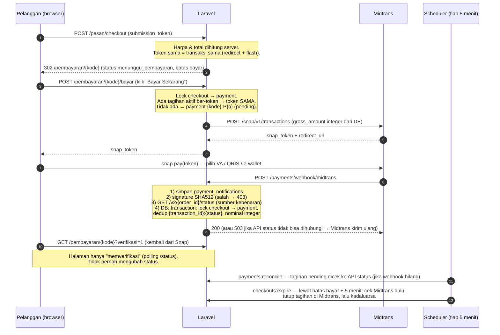

# Pembayaran Online (Midtrans Snap)

Dokumen ini menjelaskan alur pembayaran transaksi keranjang lewat Midtrans Snap, status yang dipakai,
konfigurasi, cara uji di sandbox, operasional (cron/queue), rollback, dan checklist sebelum production.

Seluruh fitur berada di balik flag **`PAYMENT_ENABLED`**:

- `PAYMENT_ENABLED=false` (default): website berjalan seperti sebelumnya (gateway dummy untuk tester, tombol
  "Konfirmasi Lunas" admin). Job `checkouts:expire` tidak menutup transaksi apa pun.
- `PAYMENT_ENABLED=true`: transaksi keranjang dibayar lewat Midtrans Snap. Status lunas **hanya** berasal dari
  konfirmasi Midtrans (webhook, rekonsiliasi, atau tombol admin "Cek status ke Midtrans").

Pesanan kasir walk-in tidak terpengaruh flag ini.

---

## 1. Diagram alur



Ringkasnya dalam teks:

```
checkout ──► menunggu_pembayaran ──(webhook/reconcile/admin cek: settlement)──► lunas ──► pesanan dikerjakan
                    │
                    ├─(pelanggan "Batalkan", Midtrans cancel)──────────────► dibatalkan ─┐
                    ├─(deny / failure)─────────────────────────────────────► gagal ──────┼─► "Pesan Lagi"
                    └─(expire / batas bayar + 5 menit lewat)─────────────────► kadaluarsa ─┘
```

---

## 2. Daftar status

### Transaksi (`checkouts.status`) — status pembayaran

| Status | Arti | Diubah oleh |
|---|---|---|
| `menunggu_pembayaran` | Baru dibuat, belum dibayar | — (awal) |
| `lunas` | Dibayar (dikonfirmasi Midtrans) | webhook, reconcile, admin (cek status / pelunasan manual saat flag mati) |
| `gagal` | Ditolak Midtrans (deny/failure) | webhook, reconcile |
| `kadaluarsa` | Lewat batas bayar | webhook (expire), reconcile, scheduler |
| `dibatalkan` | Dibatalkan pelanggan / cancel di Midtrans | pelanggan, webhook, reconcile |

`lunas`, `gagal`, `kadaluarsa`, `dibatalkan` adalah status akhir. Aturan ada di `App\Services\OrderStateMachine`,
setiap perubahan dicatat di `order_status_logs` (kolom `actor_type`: pelanggan / admin / pegawai / webhook /
reconcile / scheduler / system).

`checkouts.pending_reason` (informasi untuk pelanggan, bukan status): `menunggu_transfer` (VA sudah terbit),
`popup_ditutup` (jendela Snap ditutup), `ditolak`, `kedaluwarsa`.

### Pesanan (`orders.status`) — status pengerjaan

`pending → diproses → siap_diambil → selesai`

- Hanya admin/pegawai, hanya setelah transaksi lunas. Maju boleh melompat.
- `selesai` final untuk pegawai. Admin boleh mengoreksi mundur dengan catatan wajib; dari `selesai` hanya
  dalam 24 jam sejak ditandai selesai.

### Tagihan (`payments.status`)

| Status | Arti |
|---|---|
| `pending` | Tagihan aktif (maksimal **1** per transaksi, dijaga UNIQUE `pending_owner`) |
| `paid` | Lunas |
| `failed` | Gagal dibuat di Snap / ditolak / dianggap macet |
| `expired` | Ditutup (kedaluwarsa, dibatalkan, atau digantikan tagihan lain yang lunas) |

`payments.reference` = `order_id` Midtrans = `{kode transaksi}-P{n}`. Percobaan baru selalu memakai nomor baru
(Midtrans menolak `order_id` ganda). `transaction_id` bisa berganti untuk `order_id` yang sama (pelanggan ganti
metode di Snap); yang lama disimpan di `meta.previous_transaction_ids`.

---

## 3. Arti `payments.review_flag`

Uang pelanggan **masuk**, tetapi tidak boleh dipakai melunasi transaksi. Status transaksi tidak diubah,
webhook tetap dijawab 200 (agar Midtrans tidak mengirim ulang terus), dan pembayaran muncul di
**Admin → Perlu Refund**.

| Flag | Kapan terjadi | Yang perlu dilakukan admin |
|---|---|---|
| `amount_mismatch` | `gross_amount` dari Midtrans ≠ total tagihan (dibandingkan sebagai integer rupiah) | Cek di dashboard Midtrans, refund, tandai |
| `duplicate_paid_needs_refund` | Transaksi sudah lunas lewat tagihan lain, lalu tagihan kedua juga dibayar (atau `order_id` sama dibayar dengan `transaction_id` lain) | Refund kelebihan bayar, tandai |
| `paid_after_closed` | Dibayar setelah transaksi `kadaluarsa` / `gagal` / `dibatalkan` | Refund (atau hubungi pelanggan), tandai |

"Tandai sudah direfund" wajib catatan (min. 5 karakter, mis. ID refund Midtrans / nomor bukti transfer); mengisi
`refunded_at`, `refunded_by`, `refund_note` dan menulis log `payment.refund_marked`. Klik ganda tidak menimpa
catatan pertama. Flag tetap tersimpan sebagai jejak (tab "Sudah Direfund").

---

## 4. Variabel `.env`

| Variabel | Default | Keterangan |
|---|---|---|
| `PAYMENT_ENABLED` | `false` | Saklar utama Midtrans |
| `MIDTRANS_IS_PRODUCTION` | `false` | `false` = sandbox (`app.sandbox.midtrans.com` / `api.sandbox.midtrans.com`) |
| `MIDTRANS_SERVER_KEY` | — | **Rahasia, backend saja.** Dipakai untuk Basic Auth API & verifikasi signature |
| `MIDTRANS_CLIENT_KEY` | — | Boleh tampil di halaman (atribut `data-client-key` snap.js) |
| `MIDTRANS_HTTP_TIMEOUT` | `15` | Detik, timeout request ke Midtrans |
| `MIDTRANS_IN_FLIGHT_SECONDS` | `45` | Tagihan tanpa snap_token lebih lama dari ini dianggap macet → ditutup, dibuat `-P{n+1}` |
| `MIDTRANS_ENABLED_PAYMENTS` | `bca_va,bni_va,bri_va,permata_va,echannel,other_va,gopay,shopeepay,qris` | Kartu kredit sengaja tidak diaktifkan |
| `PAYMENT_EXPIRY_MINUTES` | `60` | Batas bayar transaksi (juga durasi expiry Snap) |
| `APP_URL` | — | Dipakai untuk URL finish Snap; harus URL publik saat uji lewat ngrok |

Variabel lama (`PAYMENT_GATEWAY`, `PAYMENT_DUMMY_*`, `PAYMENT_IDEMPOTENCY_*`) tetap berlaku saat flag mati.
Setelah mengubah `.env` di server yang memakai cache config, jalankan `php artisan config:clear` (atau
`config:cache` lagi).

---

## 5. Setting dashboard Midtrans (sandbox)

1. Login https://dashboard.sandbox.midtrans.com → **Settings → Access Keys**: salin Server Key & Client Key ke
   `MIDTRANS_SERVER_KEY` / `MIDTRANS_CLIENT_KEY`.
2. **Settings → Configuration** (bagian *Snap Preferences* / *Payment*):
   - **Payment Notification URL**: `https://<domain-publik>/payments/webhook/midtrans`
     (method POST, tanpa CSRF; keamanan lewat signature + konfirmasi API status).
   - **Finish Redirect URL**: `https://<domain-publik>/akun`
     Aplikasi sudah mengirim `callbacks.finish` per transaksi (`/pembayaran/{kode}?verifikasi=1`), yang
     mengalahkan setelan dashboard; URL dashboard hanya cadangan.
   - **Unfinish / Error Redirect URL**: `https://<domain-publik>/akun`
3. Tombol **"Test notification URL"** di dashboard mengirim `order_id` yang tidak ada di database: aplikasi
   menjawab `200` dengan `unknown_reference` (dicatat di `payment_notifications`). Itu normal.
4. Bayar VA/QRIS sandbox lewat simulator: https://simulator.sandbox.midtrans.com

---

## 6. Expose webhook dari komputer lokal

Midtrans harus bisa menjangkau URL webhook. Untuk Laragon lokal:

- **ngrok**
  ```bash
  ngrok http --host-header=rewrite <host-laragon-anda>.test:80   # atau: ngrok http 8000 jika memakai php artisan serve
  ```
  Pakai URL `https://xxxx.ngrok-free.app` sebagai domain di Notification URL, dan isi `APP_URL` dengan URL
  yang sama (agar URL finish Snap mengarah ke ngrok), lalu `php artisan config:clear`.
- **Laragon Share** (jika tersedia di versi Laragon Anda): menu Laragon → *www* → *Share*, yang memakai ngrok
  di belakangnya. Salin URL publik yang muncul.

URL ngrok gratis berganti setiap restart: perbarui Notification URL di dashboard setiap kali.

Cek cepat: kirim notifikasi palsu tanpa signature → harus `403` dan tercatat di `payment_notifications`
dengan `signature_valid = 0`.

---

## 7. Scheduler (cron) dan queue worker

Dua command dijadwalkan di `routes/console.php`, masing-masing **tiap 5 menit** dengan `withoutOverlapping()`:

| Command | Fungsi |
|---|---|
| `payments:reconcile` | Tagihan Midtrans `pending` dicek ke API status (jalur yang sama dengan webhook). Menangkap pembayaran saat webhook hilang. Dilewati jika `MIDTRANS_SERVER_KEY` kosong. |
| `checkouts:expire` | Transaksi `menunggu_pembayaran` yang batas bayarnya lewat > 5 menit (`--grace=5`). Cek Midtrans dulu: sudah dibayar → lunas; masih pending → tutup tagihan di Midtrans, lalu `kadaluarsa`. Status tidak bisa dicek → dilewati, dicoba lagi. Transaksi lama tanpa `payment_deadline` memakai `created_at + PAYMENT_EXPIRY_MINUTES`. Tidak berjalan jika `PAYMENT_ENABLED=false`. |

**Linux (production)** — crontab user web server:

```cron
* * * * * cd /var/www/laundry-coin && php artisan schedule:run >> /dev/null 2>&1
```

**Windows / Laragon (lokal)** — biarkan terminal ini terbuka:

```bash
php artisan schedule:work
```

(atau Task Scheduler Windows yang menjalankan `php artisan schedule:run` setiap menit di folder project).

Jalankan manual kapan saja: `php artisan payments:reconcile` / `php artisan checkouts:expire`.
`withoutOverlapping` memakai cache lock (`CACHE_STORE=database` sudah cukup).

**Queue worker**: alur pembayaran **tidak** memakai queue (webhook, rekonsiliasi, kedaluwarsa berjalan
sinkron). Worker hanya diperlukan untuk job lain di aplikasi (`QUEUE_CONNECTION=database`):

```bash
php artisan queue:work --tries=3 --max-time=3600
```

Di production jalankan lewat Supervisor/systemd agar otomatis hidup lagi, dan `php artisan queue:restart`
setiap deploy.

---

## 8. Rollback migration

Semua migration pembayaran bersifat aditif. **Selalu backup dulu**:

```bash
mysqldump -uroot --single-transaction --routines --triggers "Sistem-Manajemen-Laundry" > ../backup-db/laundry_YYYYMMDD_HHMM.sql
```

Rollback berjalan mundur dari migration terakhir (`php artisan migrate:rollback --step=N`):

| # | Migration | `down()` | Catatan |
|---|---|---|---|
| 8 | `2026_11_09_000008_add_refund_tracking_to_payments_table` | Hapus `refunded_at`, `refunded_by`, `refund_note` | **Catatan refund hilang** |
| 7 | `2026_11_09_000007_create_payment_notifications_table` | Drop tabel `payment_notifications` | Arsip notifikasi mentah hilang |
| 6 | `2026_11_08_000006_add_single_pending_guard_to_payments_table` | Hapus UNIQUE + kolom virtual `pending_owner` | Tidak ada data hilang (kolom virtual) |
| 5 | `2026_11_08_000005_add_midtrans_columns_to_payments_table` | Hapus `snap_token`, `transaction_id`, `payment_type`, `review_flag` | Data Midtrans per tagihan hilang |
| 4 | `2026_11_08_000004_add_dibatalkan_to_checkouts_status` | ENUM kembali tanpa `dibatalkan` | **Menolak** jika ada transaksi berstatus `dibatalkan` |
| 3 | `2026_11_08_000003_create_order_status_logs_table` | Drop `order_status_logs` | Riwayat status hilang |
| 2 | `2026_11_08_000002_add_service_name_snapshot_to_orders_table` | Hapus `service_name_snapshot` | Nama layanan kembali dari tabel `services` |
| 1 | `2026_11_08_000001_add_payment_tracking_to_checkouts_table` | Hapus `payment_deadline`, `paid_at`, `pending_reason` + index | — |

Contoh: membatalkan Tahap 5 saja = `php artisan migrate:rollback --step=2`.
Matikan fitur **tanpa** rollback: cukup `PAYMENT_ENABLED=false` + `php artisan config:clear` — semua kolom baru
nullable dan diabaikan alur lama.

---

## 9. Checklist sebelum pindah ke production

- [ ] Semua tes manual sandbox lulus (lihat laporan / daftar uji end-to-end).
- [ ] `php artisan test` lulus dengan `PAYMENT_ENABLED=false` **dan** `PAYMENT_ENABLED=true`.
- [ ] Akun Midtrans production sudah aktif (verifikasi bisnis selesai) dan metode bayar yang dipakai disetujui.
- [ ] `.env` production: `MIDTRANS_IS_PRODUCTION=true`, Server/Client Key **production** (bukan `SB-Mid-…`),
      `APP_ENV=production`, `APP_DEBUG=false`, `APP_URL` = domain HTTPS.
- [ ] Server Key tidak pernah ada di repo, log, atau halaman (hanya Client Key di snap.js). `.env` ada di `.gitignore`.
- [ ] Dashboard Midtrans production: Notification URL `https://domain/payments/webhook/midtrans`,
      Finish/Unfinish/Error URL `https://domain/akun`. Uji "Test notification URL" → 200.
- [ ] HTTPS aktif untuk seluruh situs, termasuk URL notifikasi (sangat disarankan Midtrans untuk production).
- [ ] Cron `schedule:run` tiap menit terpasang; cek `php artisan schedule:list`.
- [ ] Queue worker berjalan di Supervisor (untuk job non-pembayaran).
- [ ] Backup database otomatis harian; uji restore sekali.
- [ ] Gateway dummy mati di production (otomatis: `PAYMENT_DUMMY_ENABLED` diabaikan saat `APP_ENV=production`).
- [ ] Ganti password admin/pegawai (dump SQL lama pernah ter-commit di riwayat git).
- [ ] Admin tahu halaman **Perlu Refund** dan prosedur refund di dashboard Midtrans.
- [ ] `php artisan config:cache && php artisan route:cache && php artisan view:cache` setelah deploy.
- [ ] Pantau log `midtrans.*` dan tabel `payment_notifications` (hasil `invalid_signature` berulang = ada yang mencoba memalsukan notifikasi).
